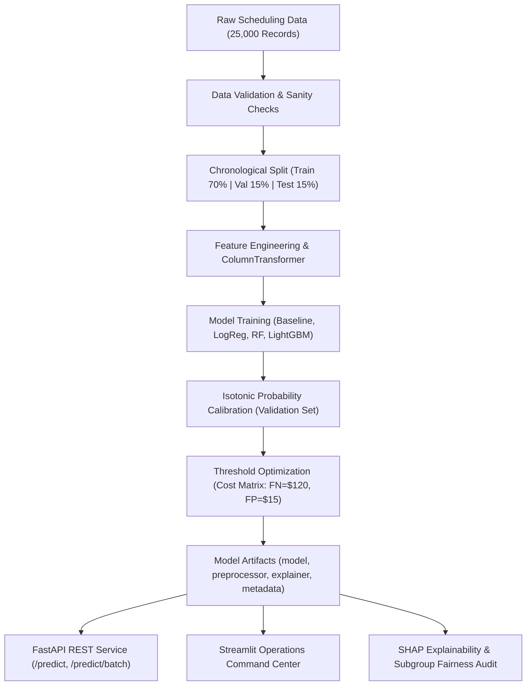

# Hospital Appointment No-Show Prediction System
### Algions AI Labs — Advanced AI & Machine Learning Assessment
**Domain:** Hospital Management & Clinic Operations  
**Role:** AI & Machine Learning  
**Pipeline Version:** `1.0.0`

[](https://www.python.org/)
[](https://fastapi.tiangolo.com/)
[](https://streamlit.io/)
[](https://lightgbm.readthedocs.io/)
[](https://docs.pytest.org/)

---

## 📌 Executive Overview

Outpatient clinic no-shows result in billions of dollars in lost healthcare capacity, idle physician time, and inflated patient waitlists. This production-grade machine learning system delivers an **operational decision-support tool** to predict the likelihood of an appointment being missed at booking confirmation time.

### Core Value & Capabilities:
- **Strictly Non-Clinical Decision Support:** Predicts administrative attendance probability only; strictly contains **no clinical diagnoses, medical urgency, prescriptions, or treatment outcomes**.
- **Zero Temporal Leakage:** Rigorous chronological partitioning: **Train (70%, Jan–Sep 2025)**, **Validation (15%, Sep–Nov 2025)**, and **Test (15%, Nov–Dec 2025)**. Historical patient attendance metrics are computed via expanding windows prior to booking time.
- **Calibrated Probability Estimation:** Raw LightGBM tree outputs are calibrated via isotonic regression, reducing the **Brier score to 0.1431**.
- **Cost-Optimal Thresholding ($t^* = 0.12$):** Balances healthcare operational trade-offs ($C_{\text{FN}} = \$120$ for empty doctor slots vs. $C_{\text{FP}} = \$15$ for staff reminders), capturing **93.1% of true no-shows** and cutting operational waste by **43.8% ($34,755 saved on 3,750 appointments)**.
- **Explainability (SHAP):** Features local and global SHAP attributions explaining the exact drivers of every prediction.
- **Dual Interfaces:** High-performance **FastAPI REST API** and interactive **Streamlit Operations Command Center**.

---

## 🏛️ System Architecture



---

## 🚀 Quick Start Guide

### 1. Environment Setup
Clone the repository and initialize the Python virtual environment:
```bash
# Navigate to project directory
cd "Algions AI -Project"

# Create and activate virtual environment
python3 -m venv .venv
source .venv/bin/activate

# Upgrade pip and install dependencies
pip install --upgrade pip
pip install -r requirements.txt
```

### 2. Generate Synthetic Dataset
Generate the leak-free, reproducible synthetic appointment dataset (25,000 records, 8,000 patients):
```bash
python src/data_generator.py
```
*Outputs: `data/raw/appointments.csv`*

### 3. Train Pipeline, Calibrate & Evaluate
Execute end-to-end training, probability calibration, threshold search, SHAP attribution, and figure generation:
```bash
python src/train.py
```
*Outputs:*
- `artifacts/preprocessor.joblib`: Preprocessing pipeline
- `artifacts/model.joblib`: Champion LightGBM model
- `artifacts/calibrated_model.joblib`: Isotonic calibrated model
- `artifacts/explainer.joblib`: SHAP TreeExplainer
- `artifacts/metadata.json`: Experiment metrics and thresholds
- `artifacts/figures/`: High-resolution evaluation plots (`roc_pr_curves.png`, `calibration_curve.png`, `cost_curve_thresholds.png`, `confusion_matrices.png`, `shap_summary.png`, `subgroup_fairness.png`)

---

## 🧪 Acceptance Test Demonstration

Run the automated test suite to verify all acceptance criteria specified in the brief:
```bash
pytest -v tests/
```

### Verified Acceptance Criteria:
1. **Dataset Split & Pipeline Reproducibility:** `test_chronological_split_leakage_safety` and `test_preprocessor_pipeline_transformation` confirm clean chronological separation and reproducible preprocessing.
2. **Held-Out Test Set Metrics:** `test_real_inference_not_hardcoded` validates model metrics on unseen future test data ($N=3,750$).
3. **Genuine Dynamic Inference:** `test_real_inference_not_hardcoded` submits distinct patient profiles (low-risk vs. high-risk) and proves the loaded artifact produces dynamically computed probabilities ($0 \le p \le 1$).
4. **Local Prediction Explainability:** `test_shap_local_explainability_instance` proves SHAP feature contributions are computed for single predictions.
5. **Zero Clinical / Leakage Contamination:** `test_synthetic_data_generator_constraints` validates that no diagnosis, ICD code, medical urgency, or clinical notes exist in the data.

---

## 🌐 Running the Inference Interfaces

### Option A: Interactive Streamlit Operations Command Center
Launch the web dashboard for clinic operations staff:
```bash
streamlit run app/streamlit_app.py
```
Open [http://localhost:8501](http://localhost:8501) in your browser.

**Dashboard Features:**
- **🎯 Single Appointment Triage:** Interactive sliders to score an appointment, view risk probability gauge, risk tier (`Low`, `Medium`, `High`), recommended staff action, and real-time SHAP waterfall chart.
- **📋 Daily Schedule Batch Triage:** View upcoming clinic roster, filter high-risk appointments, and export prioritized CSV call sheet.
- **📊 Model Performance & Calibration:** View ROC, PR, Calibration, and Confusion Matrix plots, plus an interactive operational cost calculator.
- **⚖️ Subgroup Fairness & Ethics:** Inspect error slices across age and financial subsidy tiers.

---

### Option B: Production FastAPI REST API
Start the FastAPI ASGI server:
```bash
uvicorn src.api:app --host 0.0.0.0 --port 8000 --reload
```
Interactive Swagger API documentation available at: [http://localhost:8000/docs](http://localhost:8000/docs)

#### Sample cURL Request (Single Prediction):
```bash
curl -X POST "http://localhost:8000/predict" \
     -H "Content-Type: application/json" \
     -d '{
       "appointment_id": "APT-7721",
       "patient_id": "PAT-4021",
       "booking_date": "2025-06-01",
       "appointment_date": "2025-06-20",
       "lead_time_days": 19,
       "patient_age": 27,
       "distance_miles": 18.5,
       "financial_assistance": 1,
       "clinic_department": "Orthopedics",
       "booking_channel": "Online Portal",
       "appointment_time_slot": "Late Afternoon (14:00-17:00)",
       "appointment_day_of_week": "Friday",
       "sms_reminder_sent": 0,
       "prior_appointments_count": 3,
       "prior_no_shows_count": 2,
       "prior_no_show_rate": 0.50,
       "is_first_appointment": 0
     }'
```

#### Sample API Response:
```json
{
  "appointment_id": "APT-7721",
  "patient_id": "PAT-4021",
  "no_show_probability": 0.5284,
  "is_at_risk": true,
  "risk_tier": "High",
  "decision_threshold": 0.12,
  "recommended_action": "Priority phone outreach by hospital scheduling coordinator 3 days prior. Eligible for flexible scheduling buffer.",
  "top_factors": [
    {
      "feature": "prior_no_show_rate",
      "shap_value": 0.5124,
      "direction": "Increases Risk"
    },
    {
      "feature": "sms_reminder_sent_0",
      "shap_value": 0.3812,
      "direction": "Increases Risk"
    },
    {
      "feature": "lead_time_days",
      "shap_value": 0.2941,
      "direction": "Increases Risk"
    }
  ],
  "disclaimer": "DECISION-SUPPORT NOTICE: This prediction is for operations planning (reminders, scheduling buffers) only. It must NEVER be used to withhold care, cancel slots, or alter clinical treatment."
}
```

---

## 📊 Summary of Model Performance

Evaluated on the held-out test set ($N = 3,750$, strictly chronologically unseen):

| Metric | Dummy Baseline | Logistic Regression | Random Forest | Calibrated LightGBM ($t=0.50$) | **Calibrated LightGBM ($t^*=0.12$)** |
| :--- | :---: | :---: | :---: | :---: | :---: |
| **ROC-AUC** | 0.5000 | 0.6500 | 0.6145 | 0.6307 | **0.6307** |
| **PR-AUC** | 0.1808 | 0.3107 | 0.2644 | 0.2716 | **0.2716** |
| **Brier Score** | 0.1481 | 0.2307 | 0.2005 | **0.1431** | **0.1431** |
| **Recall** | 0.00% | 57.37% | 32.01% | 2.80% | **93.07%** |
| **Precision** | 0.00% | 25.76% | 27.43% | 54.29% | **19.56%** |
| **F1-Score** | 0.0000 | 0.3556 | 0.2954 | 0.0533 | **0.3233** |
| **False Negatives (Missed)** | 678 | 289 | 461 | 659 | **47** |
| **Total Operational Cost** | \$81,360 | \$51,495 | \$63,930 | \$79,320 | **\$44,565** |
| **Net Operational Savings** | \$0 | \$29,865 | \$17,430 | \$2,040 | **\$34,755 (43.8% saved)** |

---

## ⚖️ Responsible AI & Ethical Boundaries

1. **Non-Clinical Guarantee:** The model deliberately avoids predicting disease diagnosis, treatment efficacy, clinical urgency, or patient health conditions.
2. **Zero Care Deprivation:** Predictions are strictly decision-support for operational triage. A patient flagged as high-risk will **never** have their appointment canceled or delayed.
3. **Equitable Outreach:** Patients flagged with financial subsidy or transportation barriers receive supportive transit coordination and appointment rescheduling assistance, rather than penalties.
4. **Human-in-the-Loop:** All reminder adjustments, buffer assignments, and telephone calls are executed with human oversight.

---

## 📁 Repository Directory Structure

```
├── README.md                          # Documentation and acceptance guides
├── REPORT.md                          # Comprehensive Senior ML Engineer technical report
├── requirements.txt                   # Frozen dependency requirements
├── Makefile                           # Development automation commands
├── data/
│   ├── raw/appointments.csv          # 25,000 synthetic scheduling records
├── src/
│   ├── __init__.py
│   ├── config.py                      # System configuration, paths, features, costs
│   ├── data_generator.py              # Reproducible, leak-free synthetic generator
│   ├── data_loader.py                 # Data validation and chronological splitting
│   ├── features.py                    # Domain feature engineering & Scikit-Learn transformers
│   ├── train.py                       # Training, calibration, threshold search, artifact export
│   ├── evaluate.py                    # Metrics, curves, cost analysis, fairness audit
│   ├── explainability.py              # SHAP TreeExplainer, local and global attribution
│   ├── schemas.py                     # Pydantic v2 schemas for API validation
│   └── api.py                         # Production FastAPI service
├── app/
│   └── streamlit_app.py               # Streamlit Operations Command Center
├── artifacts/
│   ├── model.joblib                   # Serialized LightGBM champion
│   ├── calibrated_model.joblib        # Serialized Isotonic Calibrated model
│   ├── preprocessor.joblib            # Serialized feature transformer pipeline
│   ├── explainer.joblib               # Serialized SHAP explainer
│   ├── metadata.json                  # Experiment metadata and metrics
│   └── figures/                       # High-resolution diagnostic figures
├── tests/
│   ├── test_data.py                   # Data integrity, non-clinical constraints, leak-free splits
│   ├── test_pipeline.py               # Transformer array transformations, feature shapes
│   ├── test_inference.py              # Artifact loading, non-hardcoded dynamic scoring tests
│   └── test_api.py                    # FastAPI endpoint integration tests
└── submission/
    ├── SUBMISSION_FORM.md             # Completed Algions assessment submission form
    └── DEMO_SCRIPT.md                 # 3-5 minute video presentation script
```
